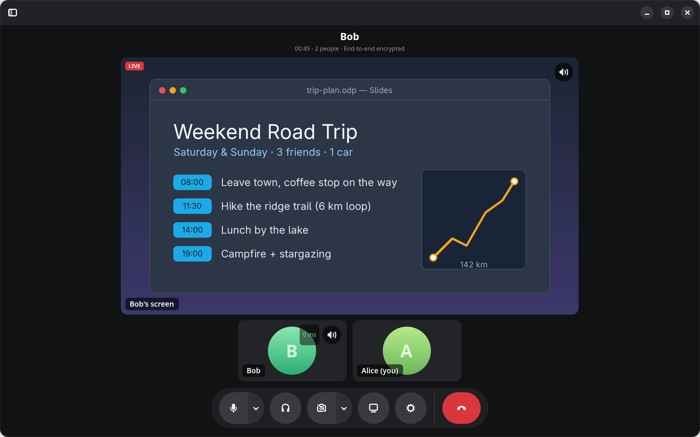

# Parley

Private voice, video and screen-share calls for Linux, straight between friends.
No accounts, no port forwarding, and no server you have to run or pay for.



- **1:1 and group calls** (up to 3 people). Everyone can talk, show their webcam and
  share their screen with sound at the same time.
- **End-to-end encrypted.** Every connection is QUIC + TLS 1.3, authenticated by each
  person's own key. Nobody watching the traffic can see or hear anything.
- **Share a code once.** Your code works like a PGP key: send it to a friend once
  (Signal, email, anything), or let them scan it as a QR code with their webcam, and
  you're contacts. Groups get their own code, which is only needed for people who
  aren't already your contacts.
- **Discord-style call screen**: video tiles with green speaking rings, click-to-focus,
  double-click for fullscreen, per-person volume, mute/deafen, mic and camera pickers,
  and previews of what you're sending.
- **Screen share with app audio.** Share all desktop audio or only chosen apps.
  Parley's own audio (your friends' voices) is never captured, so there's no echo.
- **Resilient groups.** Someone dropping out doesn't end the call for everyone else.
  Parley reconnects automatically after network blips, and anyone can rejoin with one
  click.

## Install

```bash
git clone https://github.com/lpuq/parley.git
cd parley
./install.sh
```

That's the whole setup. The installer needs only Flatpak, which Fedora Workstation
ships with; on other distros it offers to install it with your package manager (the only
step that can ask for your password). It then fetches everything else into your user
account: Flathub, the GNOME 51 SDK, Rust and the H.264 codecs (about 2 GB, once). It
compiles Parley in the Flatpak sandbox (about 5–10 minutes the first time) and installs
it into your app menu. Running it again updates Parley in a minute or two.

- `./install.sh --bundle` also writes `parley-<arch>.flatpak`. Put that file next to
  `install.sh` on another machine of the same architecture and `./install.sh` installs it
  in seconds, with no compiling.
- `flatpak/cross-bundle.sh` (on an ARM machine) cross-compiles `parley-x86_64.flatpak`
  for Intel/AMD machines, using the host's clang/lld and the x86_64 GNOME SDK.
- `./install.sh --native` builds a regular binary instead, offering to install the
  needed `-devel` packages.
- `./install.sh --uninstall` removes Parley; its notes explain how to free the build tools.

Runtime needs: PipeWire (with pipewire-pulse) and GStreamer 1.22+ with the *good*,
*bad*, *ugly* and *libav* plugin sets plus the GTK 4 video sink (`gstreamer1-plugin-gtk4`
on Fedora, `gstreamer1.0-gtk4` on Debian/Ubuntu). Screen sharing uses
xdg-desktop-portal, which works on GNOME, KDE, niri, Hyprland, Sway and others.

## Building it yourself (no prebuilt binaries)

You don't have to trust the release bundles. `./install.sh` compiles Parley from this
source tree inside the Flatpak SDK; it never downloads a Parley binary. Everything it
fetches comes from Flathub (signed runtimes, SDK, Rust toolchain and codecs) and
crates.io (Rust dependencies, pinned with checksums in `Cargo.lock`).

With the standard Flatpak tooling instead of the installer:

```bash
flatpak remote-add --user --if-not-exists flathub https://dl.flathub.org/repo/flathub.flatpakrepo
flatpak install --user flathub org.freedesktop.Platform.codecs-extra//26.08-extra   # H.264
flatpak-builder --user --install --install-deps-from=flathub --force-clean \
    build-dir flatpak/io.github.parley.Parley.yml
```

The manifest builds offline: `flatpak/cargo-sources.json` lists every crate with its
checksum (regenerate it with `flatpak/gen-cargo-sources.py` after changing
`Cargo.lock`).

Without Flatpak, `./install.sh --native` installs the build dependencies with your
package manager (dnf, apt or pacman) and builds a regular binary. By hand on Fedora:

```bash
sudo dnf install cargo clang-devel gtk4-devel libadwaita-devel gstreamer1-devel \
    gstreamer1-plugins-base-devel pipewire-devel gstreamer1-plugins-good \
    gstreamer1-plugins-bad-free gstreamer1-plugins-ugly gstreamer1-plugin-libav gstreamer1-plugin-gtk4
cargo build --release --locked
./target/release/parley
```

### Verifying a release bundle

If you do use a `.flatpak` from the Releases page, check it against `SHA256SUMS`
from the same release:

```bash
sha256sum -c SHA256SUMS --ignore-missing
flatpak install --user parley-x86_64.flatpak
```

## Using it

1. **First launch:** pick the name friends will see.
2. **Add a friend:** press **Copy my code** and send it to them, or **Show my QR code**
   and let them scan it (**+** → *Scan QR code with camera*). Once they've added you,
   they can call you. The first time they do, you can save
   them back with one click, so only one of you has to share a code.
3. **Call:** press the green phone button next to a friend.
4. **Group call:** menu → **New group**, then tick your friends. Press **Join** to ring
   everyone. Friends who are your contacts don't need any code. For anyone else,
   use **Copy invite code** or **Show invite QR code** on the group. Later, anyone in the group presses **Join**
   to start or rejoin the call.
5. **In a call:** **M** mutes and **D** deafens. Use the arrows next to the mic and
   camera buttons to switch devices. The screen button opens the share options
   (quality, sound), then your desktop's own window/screen picker.

Closing the window keeps Parley running so friends can still reach you (you can turn
this off in Settings). Settings → General → *Start when I log in* starts it
automatically.

## How it works

```
 ┌────────── GTK4 / libadwaita UI ──────────┐
 │ sidebar · call grid · dialogs · settings │
 └──────┬───────────────────────────▲───────┘
        │ commands                  │ events
 ┌──────▼───────────────────────────┴───────┐      ┌───────────────────────┐
 │ net.rs  call engine (tokio actor)        │      │ media/ (GStreamer)    │
 │  ringing, group auth, full-mesh,         │◄────►│ mic → webrtcdsp →     │
 │  duplicate resolution, auto-reconnect    │ hub  │   Opus → RTP          │
 │ iroh QUIC: dial by public key, hole      │      │ cam/screen → H.264    │
 │ punching, encrypted relay fallback       │      │ mixer + echo probe    │
 └──────────────────────────────────────────┘      │ appaudio (PipeWire)   │
                                                   └───────────────────────┘
```

- **Connectivity:** [iroh](https://iroh.computer) dials peers by public key. It
  hole-punches a direct UDP path when it can. When it can't (strict NATs), it falls back
  to forwarding the already-encrypted packets through a public relay. Peers find each
  other through iroh's public discovery service. These relays and discovery servers are
  run for free by n0 (the iroh developers). They only ever see encrypted bytes and
  public keys. No setup is needed, and nobody in the call hosts anything. Some
  rendezvous point is unavoidable when nobody port-forwards; this design keeps it
  content-blind.
- **Identity & contacts:** each install has an ed25519 key
  (`~/.local/share/parley/identity.key`, mode 0600). A contact code is your public key
  plus your name. Calls are authenticated against that key, so nobody can impersonate a
  contact.
- **Groups:** a group code carries a random 256-bit secret. Joining proves knowledge of
  it with an HMAC bound to both participants' keys. A member who rings a contact for
  the group includes the invite inside the encrypted connection, so contacts can join
  without ever seeing the code.
- **Media transport** (one QUIC connection per pair of people):
  - Audio: Opus (20 ms frames, in-band FEC) in RTP over unreliable QUIC datagrams.
    Playback is scheduled from the sender's RTP timestamps (anchored to the fastest
    packets), not from arrival times, and the jitter buffer adapts between 80 and 400 ms
    to cover 97% of packets. On choppy Wi-Fi it grows within seconds; on a calm link it
    shrinks back slowly.
  - Video: H.264 (hardware VA-API/NVENC when available, otherwise x264 `zerolatency`) at
    a constant bitrate. Each group of pictures (GOP) goes on its own QUIC stream. If a
    link gets congested, the sender drops the stale GOP and restarts at a fresh
    keyframe instead of building up delay.
- **Screen audio:** while sharing, Parley creates a temporary private PipeWire sink.
  It links the chosen apps' output ports into it (they keep playing to your speakers
  too) and records its monitor. Streams belonging to Parley's own process and
  system DSP nodes are never linked. This is the same idea as Vesktop's venmic.
- **Echo cancellation:** WebRTC's echo canceller (`webrtcdsp`) listens to exactly what
  Parley plays, so speakers work without feedback. Noise suppression and automatic gain
  can be toggled in Settings.

## Privacy and security

- **What's encrypted:** everything between callers (audio, video, names, group
  invites) travels inside QUIC/TLS 1.3 connections authenticated by each person's
  ed25519 key. Relays forward only ciphertext.
- **What others can learn:** your contact code contains your public key and display
  name. Anyone holding it can look up how to reach you through iroh's discovery service
  and, by calling, learn your IP address, as with any peer-to-peer app. n0's relay and
  discovery servers see your IP address and public key, but not who you talk to inside
  a connection or what is said.
- **Who can ring you:** by default anyone who has your code, so a friend can add you
  and call without you adding them first. Strangers are shown with their ID next to the
  name they chose, so they can't pass as one of your contacts, and only a few calls can
  ring at once. Settings → *Allow calls from people not in my contacts* turns this off.
- **Nothing happens until you answer:** no audio or video flows on a call you haven't
  accepted. Group joins require proof of the group's secret.
- **Local data:** your private key (`identity.key`, mode 0600) and contacts live in your
  home directory (inside `~/.var/app/io.github.parley.Parley/` for the Flatpak). The log
  file (Settings → Troubleshooting) contains names and public keys but no call content.

Parley hasn't had an independent security audit. Please report problems through the
issue tracker, or privately via GitHub's security advisories.

## Development

```bash
cargo test                                  # unit tests
cargo test --lib -- --include-ignored       # + real network tests over iroh (needs internet)
cargo run --example appaudio_check          # checks screen-audio routing on your PipeWire
cargo run --example devlist                 # lists mics/speakers/cameras as Parley sees them
cargo run --example qr_image_check -- f.jpg # decodes a photo/screenshot of a QR code
PARLEY_PROFILE=alice cargo run              # separate identity/config, to run two copies
PARLEY_LOG=parley=debug cargo run           # verbose logs
```

The network tests cover a direct call, a 3-person group mesh where two members only
know the creator, leaving, rejoining without ringing, automatic reconnection after a
dropout, and in-order delivery of video GOPs plus audio datagrams.

## Known limitations / next steps

- Up to 3 people (full mesh). Larger calls would need an SFU-style forwarding peer.
- Video bitrate is constant (chosen quality preset), not yet adapted to the link.
- No Signal integration. Codes are plain text built for pasting into Signal or any
  messenger, or can be scanned as QR codes.
- The Flatpak isn't on Flathub. Publishing it would need an app ID on a domain or
  GitHub account you control (`io.github.parley.Parley` is a placeholder).

## License

Copyright © 2026 lpuq. Parley is free software under the [GNU General Public License v3.0 or later](LICENSE):
you can use, study, change and share it, and anyone who distributes a modified version
must publish its source under the same terms.
